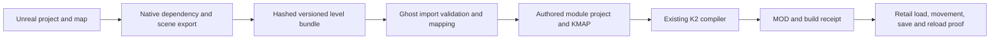

# Unreal levels into Ghost Studio and KOTOR II

Next implementation: [automated creator workflow](UNREAL_TO_KOTOR_WORKFLOW_PLAN.md).

Status: **static interchange prototype with a real Rhen Var candidate**. The
headless importer and CLI work. The general Unreal exporter, import wizard,
qualified MCP operations and native Debug workflow proof are unfinished.
Rhen Var now loads with textured architecture visible in retail KOTOR II after
the sector-packaging correction below. The user confirmed walking and collision
work; save/reload remains unverified. A build alone is not a working-map claim.

## Why a `.umap` alone is insufficient

A map stores references to mesh, material, texture and other packages. Unreal
must load the owning project and resolve those packages before exporting actual
component geometry and effective materials. String scanning a loose package is
only useful for explaining missing dependencies. It cannot recover the scene.

The September 24 Rhen Var case resolved 28 static mesh components, 20 unique
meshes and 55 effective materials in Unreal 5.8.2 CL56702186. All geometry came
from the loaded native scene. Its authored placements were preserved.

## Architecture and ownership



| Stage | Authority and owner | Handoff and acceptance |
|---|---|---|
| Source scene | Unreal; future Core.Unreal adapter | Exact engine/project/map identity; loaded dependencies; every component accounted for; source hashes unchanged |
| Bundle files | Core.IO: `src/io/unreal_level_bundle.py` | Versioned manifest, hashed map/mesh/TGA sidecars; bounded reads, path containment, duplicate-key and nonfinite checks |
| Space conversion | Core.Math: `src/math/unreal_level_space.py` | Explicit matrix convention; inverse-transpose normals; mirrored winding; no arbitrary guessed scale |
| Static scene interpretation | Core.Scene: `src/core/modules/unreal_level_import.py` | Pure conversion to existing authored module primitives; explicit material and collision intent |
| User workflow | Future Core.Workflow coordinator; GUI.Display wizard | Preview transaction, diagnostics tied to source actors, cancellation, revision-bound build |
| Compilation | Existing authored module exporter and Core.IO formats | MDL/MDX/WOK, LYT/VIS, ARE/GIT/IFO and textures packaged by existing compiler |
| Automation | Future Core.Automation typed MCP handlers | Bounded inspect/preview/build/status operations calling the same workflow, no caller code execution |
| Playability | Retail KOTOR II | Exact installed candidate hash, verified loaded module, images, movement/collision and save/reload receipt |

Unreal remains authoritative until export. A Ghost project is an independent
imported snapshot; later Ghost edits do not silently rewrite the Unreal level.
Reimport must compare stable component identities and show changed, deleted and
locally edited objects before replacing anything. This reimport UI is planned.

## Current executable interface

Run from the Ghost Studio repository with its Python dependencies:

```powershell
python scripts/import_unreal_level_bundle.py preview C:/Maps/RNV_asset_build.umap
python scripts/import_unreal_level_bundle.py preview C:/Maps/RNVBundle/level.json
python scripts/import_unreal_level_bundle.py build C:/Maps/RNVBundle/level.json --expected-sha256 <preview-manifest-sha256> --output C:/Maps/RNVBuildV1
```

The first command returns dependency hints and `convertible: false`. The second
validates a native-exported bundle. Build requires the exact preview revision,
verifies all sidecar hashes again, refuses existing output directories, and
creates a `.kmap`, texture sidecars, packaged module and `receipt.json`. It does
not launch Unreal, install game files, warp the game or claim UI acceptance.
Keep the build folder together: this initial KMAP uses absolute texture paths;
relocatable project packaging remains follow-up work.

`tests/test_unreal_level_import.py` contains a minimal complete fixture and
bundle writer. It exercises malformed inputs, transforms, texture handling,
package geometry readback and KMAP reopen. The Rhen Var native extraction is
currently a fixed local qualification recipe, not a universal exporter.

## Bundle v1 contract

- Schema: `ghoststudio.unreal-level/v1`. The manifest SHA-256 transitively binds
  each explicitly hashed sidecar. Source engine version and map package are
  required. Retain the dependency inventory and native extraction receipt as
  evidence; a bundle claiming no unresolved references is not by itself native
  proof that the exporter found every source object.
- Source scope: one fully loaded static level, no World Partition, no streaming
  levels, no unresolved packages. Each record has a stable component identity
  and is either converted or explicitly excluded with an allowed class/reason.
- Input space: Unreal centimeters, Z up, left handed. `world_matrix` stores
  row-major numbers used with column vectors, component-local to world. This is
  **not** Unreal `FMatrix` memory layout. The output basis is
  `B = diag(0.01, -0.01, 0.01, 1)`, so position is `B * M * p`.
- UV origin: bottom left. Native extraction normalizes V and material tiling
  exactly once. Triangle order must be CCW relative to supplied normals before
  import. The Rhen Var Unreal extraction returned clockwise triangles and
  therefore reversed them once; import separately handles negative determinant
  transforms. Mirrored/nonuniform transforms have regression coverage.
- Meshes: hash-referenced JSON sidecars with indexed triangles, split render
  vertices, normals, UVs and effective material IDs. Every render surface must
  fit the 16-bit vertex limit. No silent decimation or truncation.
- Materials: explicit `kotor-diffuse-v1` or `baked-diffuse-v1`, bounded TGA
  sidecar, opaque/masked/additive/alpha intent. Masked/additive emit TXI.
  Two-sided surfaces explicitly duplicate reversed faces/normals. An Unreal
  shader graph is never implicitly treated as an equivalent KOTOR shader.
- Gameplay: module resref, display name, entry position and yaw. Resrefs use
  stable source-identity hashes; actors preserve original transform metadata.
- Collision: exactly one connected authored walkmesh owns the playable sector.
  Dressing contributes render surfaces to that sector, with no extra collision.
  The sector preserves component identities/transforms and component-to-node
  mappings in KMAP metadata. Multi-sector portal links are unsupported.

The current compiler performs further source/project and native engine-contract
validation. Emitted render geometry is baked into world coordinates, so LYT
the single LYT room origin is zero. No cross-room VIS is required. These choices
preserve this small exterior candidate; they are not an occlusion or large-map
optimization strategy. The importer currently rejects unsupported classes;
it does not expand instanced meshes or evaluate procedural/Blueprint geometry.

## Rhen Var conversion decisions and evidence

Task evidence: `../ZbrushMCP/knowledge/rnv-unreal-kotor2-20260924/` from the
workspace root. `NativeV1/native-inspection.json` records native geometry;
`material-inspection.json` records material graphs and texture exports;
`channels2.json` confirms no World Partition or streaming levels.
`NativeV1/Baseline2/overview.png` and `props.png` are source Unreal captures.

The retained bundle is `CandidateV1/level.json`. Current CLI output is
`GhostBuildV3Reusable/rnvasset24.kmap` and
`GhostBuildV3Reusable/package/install/Modules/rnvasset24.mod`.
Historical `serialized-audit.json` compares the original 28 models against normalized source
geometry: 5,827 rendered triangles after explicit two-sided expansion, with
matching faces, normals, UVs and all 64 texture/TXI resources. The ground WOK
has 207 walkable triangles, reciprocal adjacency, complete AABB coverage and
four closed boundary loops. These are structural checks, not movement proof.

V1 passed those structural checks but its separate visual-only component rooms
did not show the architecture in retail. A controlled V2 build compiled the same
62 surfaces from 28 components into the ground's playable room. The building and
rubble became visible in the live game. The Scene importer now uses that policy,
with unique node names and source provenance retained in KMAP. The corrected
CLI reproduces the installed V2 module byte-for-byte: SHA-256
`a65b6f138bd226eb38013318c286cd2f88017e06b572b41865666659de37d208`.
All 73 resources match; geometry readback, WOK and texture comparisons pass.
34 focused tests include dressing-before-floor ordering and KMAP provenance.
`RetailTestV2/verification.json` records patch/debugger attachment and the live
image. The precise retail loader branch remains unproven because the decompiler
service was unavailable. Do not generalize this as a ban on vanilla empty WOKs.

This fixture derives an exterior ground walkmesh by subtracting a 0.35-meter
clearance around source geometry intersecting the 0.15–1.8-meter body-height
slab. It retains the connected area containing the spawn. This is a recorded
project-specific candidate policy; roofs, interior floors and snow slopes have
not been declared playable. It is not a generally valid automatic navmesh
algorithm for every Unreal level.

The source sky's HDR additive graph and clouds' extreme emissive multipliers
were converted to documented LDR representations. Mask thresholds and ground
UV tiling were taken from the native materials. The target uses Ghost's
fullbright profile. Native lighting, fog, volumetrics and gameplay logic are
not translated. See `CandidateV1/material-conversions.json` for exact choices.

The standalone installed PyKotor reader returned empty vertices for K2 headers.
Ghost's pre-existing owned reader explicitly fixes this layout and zero MDX
offset handling. Readback uses that reader plus separate raw engine-contract
checks; it must not be called independent retail validation. No existing MDL
reader or writer was changed for this importer.

Matched-camera preview also caught a pre-existing ModernGL front-face error.
Stock K2 `001ebo1`, extracted by KotorMCP into
`Ghost-Studio/knowledge/unreal-rnv-20260924/Stock/`, has face crosses that agree
with its normals. ModernGL was selecting CW with a right-handed view matrix.
Changing its front-face state to CCW restored the Rhen Var exterior/props without
altering any exported geometry. Two real GPU floor-facing tests failed before
the fix and pass afterward. `GhostGPUReadbackFixedV2/` holds the resulting
headless captures. Earlier CPU and GPU diagnostic images remain as failure
evidence; the CPU preview also has large-triangle/depth artifacts and is not the
acceptance renderer. This fix does not qualify the separate WGPU backend or
replace the required visible Debug test. Retail V2 captures separately verify
visible architecture; they do not qualify Ghost's native Debug workflow.

## Wizard needed to make this usable without scripts

1. **Choose map.** Accept `.umap` or `.uproject`; find the owning project from
   approved local roots. Display missing referenced packages and exact engine
   requirements with actionable repair steps. Never substitute similarly named
   assets silently. Source libraries remain read-only.
2. **Inspect in Unreal.** Use a version-qualified native exporter in an isolated
   copy. Enumerate loaded level scope, components, instance transforms, material
   overrides, dependencies and unsupported content. Bind a native receipt to the
   full source closure and exporter version. Cancellation preserves the source.
3. **Review map.** Show source and target previews with a player-size reference.
   Let creators choose spawn, playable floor meshes, dressing and excluded
   effects. Offer collision proposals with visible blocked areas and an explicit
   review step. Labels/tags may automate these choices only through a documented
   convention; no such Unreal tag convention is implemented in v1.
4. **Review materials and lighting.** Show supported direct mappings and before/
   after bakes. Unsupported dynamic graphs need an explicit bake or exclusion.
   A preview should expose alpha sorting, UV seams, mirrored faces and texture
   limits before compilation. Choose fullbright or a separately qualified bake.
5. **Build a new version.** Recheck source revision, compile through the current
   exporter, read back geometry/collision/resources, save the KMAP and a report.
   A failed build is retained as failed evidence; never install partial output.
6. **Test in KOTOR II.** Install a unique module with conflict checks and an
   uninstall receipt. Do not interrupt an unrelated active game test. Record
   loaded identity, spawn, walls/edges, camera views, party traversal and save/
   reload against that exact hash. Keep “built”, “structurally checked” and
   “verified in game” visibly distinct.

Typed MCP operations should mirror these steps (`inspect`, `preview`, `build`,
`status`, plus a separately authorized `install/test`) with job IDs and revision
tokens. These names describe the proposed API, not tools currently registered.
Never add arbitrary Python, console, shell or caller-selected script execution
to bypass adapter qualification. MCPStudio's generic Unreal route remains
disabled and its Ghost spatial route remains unconfigured in this task.

## Completion gates

The next release needs a general native exporter, bounded material baking,
collision review/annotations, relocatable KMAP assets, a workflow coordinator,
the visible import wizard and typed MCP integration. Qualify representative
mirrored geometry, masks, sky, multiple floors, narrow passages and failure
recovery before claiming general support. Streaming/World Partition, landscapes,
foliage/instances, multiple collision rooms/portals, dynamic objects and gameplay
need explicit later capabilities rather than best-effort silent conversion.

Native Debug UI proof must use the real application launched through Visual
Studio, as required by `AGENTS.md`. None is claimed by the CLI tests. Full native
payload regeneration is currently blocked by pre-existing source/payload
differences in `mdl_writer.py` (IO) and `head_skin_transfer.py` (Math). This
change registers only its own identical new files; it does not overwrite those
other edits. Scene and Rendering generation succeeded. No native DLL rebuild
is claimed.
The focused root-manifest coverage check also identifies an unrelated existing
source file, `src/core/modules/kotor_dialogue_manifest.py`, with no payload
entry. New import payload entries/hashes were checked separately and pass.

Book grounding: Jason Gregory, *Game Engine Architecture*, fourth edition,
private PDF pages 483–484 (printed 466–467), explains exporter/resource compiler/
linker separation and dependency tracking. The pipeline boundary above is a
project-specific application of that guidance. KOTOR behavior comes from Ghost
Studio's local knowledgebase, implementation and recorded fixture checks, not
from that general book. Private source material remains in local evidence.
