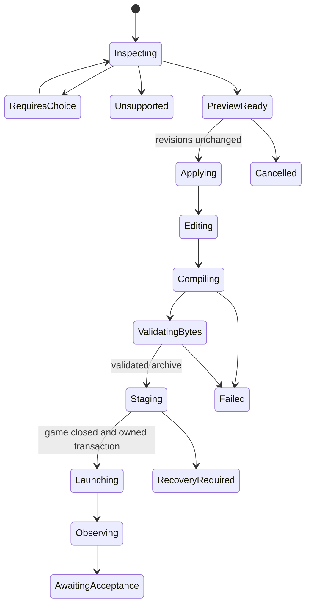

# Deterministic Unreal pipeline implementation

2026-09-24. Owner: LordVaderCW. Roadmap: T3105; no completion claim.

The creator milestone is send a supported static level, edit its spawn in Map

Studio, Build & Play, change a source prop, and repeat while preserving Ghost

edits. No AI, agent, MCP or network service is a runtime dependency. This work

continues the accepted Rhen Var experiment and the program audit in

`docs/audits/2026-09-24-program-audit/REPORT.md`.

## Boundaries and contracts

| Owner | Contract |

|---|---|

| Core.Unreal editor plugin | Native API inspection/export; actor GUID plus component identity; exact engine version; effective material slots; saved dependency closure; read-only source |

| Core.IO | Bounded hash-checked files, immutable content-addressed project assets, atomic publication and portable references |

| Core.Scene | Independent named components, source revision, local property overrides, reimport conflicts and sector projection |

| Core.Workflow | Revision-bound preview/apply/build jobs and recoverable stage/launch orchestration |

| GUI.Display / existing Map Studio | Actions, previews, source-object diagnostics, selection and explicit creator choices; no parser/compiler rules |

| Core.Automation | Optional typed service calls, separately registered and live-qualified |

Unreal snapshot schema `ghoststudio.unreal-snapshot/v1` is native source evidence.

It is deliberately separate from the existing `ghoststudio.unreal-level/v1`

Odyssey conversion bundle. A snapshot may contain unsupported items and remains

useful for inspection. A conversion bundle has explicit material and collision

intent and must pass the existing importer. The exporter never silently treats

an Unreal material graph, NavMesh or runtime behavior as a KOTOR equivalent.

The editor plugin's Python runs inside Unreal and calls its native APIs. It is

package-local under `Core.Unreal/EditorPlugin`; it is not the embedded Ghost

Python payload and does not add another Visual Studio package.

## State and jobs

KMAP retains `ghoststudio.unreal-import-state/v1`: source manifest reference,

map identity, source revision, policy version, component overrides and Ghost

module/spawn overrides. Meshes, collision and textures are hash-referenced

sidecars under `unreal_assets/`. Moving a project together with that folder

preserves the references. Import previews are non-mutating; unused immutable

cache entries may remain after cancellation.

Reimport is a three-way comparison of prior source, incoming source and local

overrides. Independent source geometry changes preserve local transforms and

spawn. Simultaneous edits to the same property require `keep_local` or

`accept_source`. Deleting a locally edited source component also requires an

explicit choice. A retained deleted object becomes local and does not ask the

same deletion question on every subsequent import. Applying a preview checks

both the current editor-state revision and the source manifest/sidecar hashes.

Job state machine:

Durable jobs must not turn `launched` into `visible`, `traversable` or

`save_reload_verified`. Install transactions must preserve unresolved backups,

use unique artifact identities and retain exact source/build hashes. The audit

found unsafe generic export rollback behavior; no new installer may inherit it

without fixing or replacing that behavior within the owning IO layer.

## Compatibility matrix

| Feature | Initial lane | Gate |

|---|---|---|

| Saved static level, StaticMeshActor/StaticMeshComponent | Native snapshot | UE 5.8.2 CL56702186, LOD0, effective section material slots |

| Mirrored/nonuniform transforms | Snapshot and existing conversion math | Named coordinate spaces, inverse-transpose normals and winding checks |

| Direct texture/constant diffuse | Explicit conversion recipe | Diffuse-only losses accepted; exact texture dependency |

| Complex materials or instances | Inspect and diagnose | Qualified bake or explicit hash-bound reviewed conversion |

| Authored collision and spawn | Existing importer | One connected playable sector, supported surfaces, valid spawn |

| Editor-only guides | Explicitly accounted exclusion | Native editor-only flag |

| Unsaved source | Block export | Save first; transient snapshot policy not yet implemented |

| ISM/HISM, Landscape, splines, PCG/Blueprint, Nanite | Diagnose | Individually qualified evaluated/baked adapters |

| Streaming/World Partition/Data Layers | Diagnose | Explicit loaded scope and qualified flatten/partition adapter |

| Unreal gameplay, Niagara, lighting parity | No equivalence | Author target semantics separately |

No Rhen Var path, actor name, terrain shape, spawn or source hash belongs in

production code. Its reviewed conversion choices belong to fixture/profile

data. Preserve its existing accepted single-sector output as a regression.

## Verification gates and progress

- [x] Preserve audit findings and safe fault reproductions.

- [x] Implement native snapshot exporter and editor command source.

- [x] Run native exporter on preserved Rhen Var project; inspect actual output.

- [x] Repeat native export and prove stable GUIDs/revisions and preservation.

- [x] Export an unrelated saved static fixture with identical exporter code.

- [x] Implement portable project asset storage and pure reimport state.

- [x] Test stale previews, local/source conflicts, deleted objects, spawn and shared-mesh isolation.

- [x] Implement native snapshot conversion recipes and detailed compatibility results.

- [x] Implement independent components, import/reimport dialog, preview/apply/cancel and controller history; native visual qualification is still pending below.

- [x] Compile independent authoring components through the preserved sector projection.

- [ ] Add durable build/status/cancel and safe retail staging/profile integration.

- [ ] Actual Ghost Debug import/edit/undo/save/reopen/reimport, launched via active Visual Studio.

- [ ] Two source-to-retail cycles, exact installed identity, traversal, save/reload and rollback.

- [ ] Optional typed MCP catalog registration and live qualification.

Only focused checks are authorized. Native editor export is not Ghost GUI

verification. Headless scene tests are not visible workflow proof. The current

game process must remain undisturbed; no save or installation is modified during

exporter qualification.

## Evidence

Working receipts are in `knowledge/unreal-pipeline-20260924/`. The decision record

passed MCPStudio's organization checker. Reused private library evidence:

Jason Gregory, *Game Engine Architecture*, 4th edition, PDF 483–484 / printed

466–467, source `game-design-911e9eb63f1f58149348248e562b336e`: exporter/compiler/

linker separation and dependency tracking. This supports the architecture;

installed Unreal source and native runs establish API behavior. Private book

content remains outside this public design document.

## Implementation checkpoint — 2026-09-24

The new Map Studio File action accepts a native snapshot or converted bundle.

The static-lane dialog makes component inclusion, collision section, spawn and

diffuse-only losses explicit. Existing material bakes can be supplied through a

hash-bound reviewed policy. Preparation and validation run in one background

worker; Cancel discards the result after the current safe IO operation finishes.

It is not a durable job API or an interruptible compiler. The Unreal menu exports

and displays the path; automatic Send-to-Ghost setup is not implemented.

Map Studio retains each source component as an independently selectable authored

room, with its source label in the outliner. The compiler alone projects them to

the qualified single playable sector. An unchanged Rhen Var authoring import

produced exactly the accepted MOD SHA-256:

`a65b6f138bd226eb38013318c286cd2f88017e06b572b41865666659de37d208`.

Both the unrelated native floor/prop fixture and the new native Rhen Var snapshot

compiled with no blocking issues. The new Rhen Var build has 73 resources; its

stable GUID identities intentionally differ from the old path-based identities.

No new build was installed or retail-qualified.

The pure property-override API remains available, while existing Map Studio

geometry tools use a second three-way comparison of baseline authored payload,

current editor payload and incoming source payload. Room IDs are stable;

surface/topology lists are atomic conflicts. Local room translations and Ghost

spawn/gameplay survive source geometry changes. Deleted locally edited rooms

require a decision and can remain local copies. This conservatively asks for a

choice when both sides edit a surface list; it does not infer topology merges.

KMAP saves retain a compact hash reference to authored geometry, a baseline

reference and resource references under `unreal_assets/`. Loading hydrates the

existing editor contract. Failed atomic KMAP replacement leaves the previous

file, dirty flag and timestamp intact. Move the whole folder to relocate it;

Save As across folders is deliberately rejected until transactional relocation

is implemented. Non-Unreal KMAP, KMAX and generic project saves still have their

pre-existing behavior; the audit's broader save/rollback findings are not fixed.

Verification: 70 focused tests passed across importer/GPU contracts, native

snapshot conversion, reimport state, workflow/controller undo/redo/save/reopen,

and task-owned native registration. Canonical Qt import resolves without widget

construction; that is only an import check. Native V3/V4 snapshot SHA-256 is

`d73ec3a4b01c8dfd021524994f7bd505ee2a09e4aa6144974f864629ba3cb328`

on both runs. Receipts: `NativeRhenVarV4`, `NativeStaticFixtureV1`,

`FixtureBuildV1`, `RhenVarProjectionBuildV1`, and `NativeRhenVarBuildV1` under

the local evidence directory. The Rhen Var reviewed material/collision choices

live in fixture data, never in production conversion code.

Scene, Tools, Workflow and GUI Display payload generators completed. IO remains

blocked on the pre-existing `mdl_writer.py` source/payload mismatch; Math remains

blocked on `head_skin_transfer.py`. Only this task's new rows were registered

there. All ten task-owned canonical payloads pass hash/RC/project/root-manifest

checks. No unrelated copy was synchronized to resolve those conflicts.

At verification time KOTOR II was active (PID 182592), and no Visual Studio

instance was active. The game was left untouched. The actual Debug UI, theme

matrix, native menu and two retail update cycles remain unqualified. Durable

build/status/cancel, closed-game transactional install/rollback, configured

KPM/debugger launch, save/reload proof and typed MCP jobs are still unfinished.

T3105 remains open; this checkpoint is not a complete Build & Play release.

Local painted/project texture overrides are authoritative over imported textures. If the source texture also changes, reimport explicitly offers keep-local or accept-source; accepting source removes the local reference without deleting its file. Local texture bytes participate in stale-preview checks.
